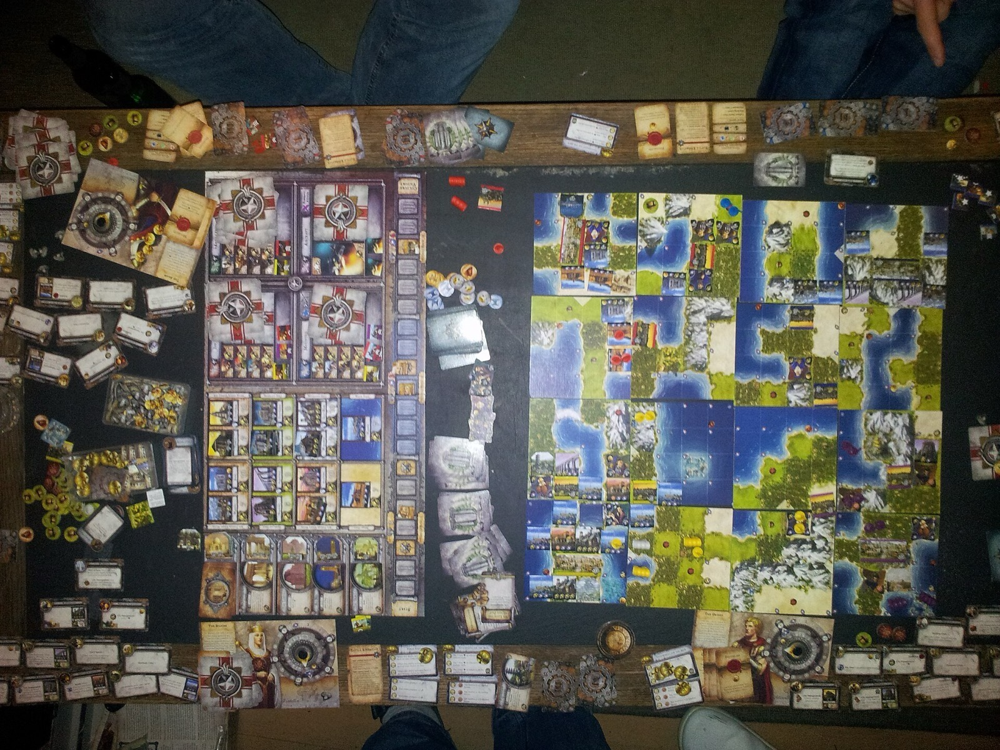
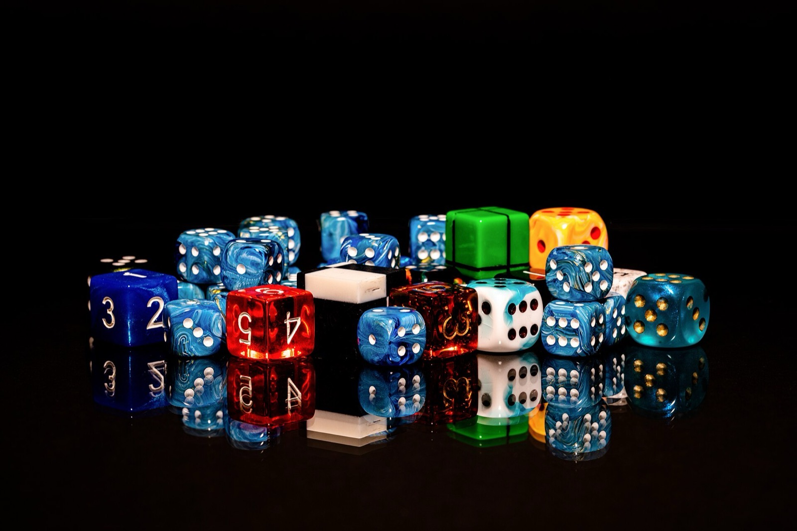

<figure class="wide">



<figcaption>[placeholder: caption] Photo: Ervaude, CC BY-SA 3.0.</figcaption>
</figure>

Lorem ipsum dolor sit amet, consectetur adipiscing elit. [Placeholder link](/garden/board-games/sample-photo/) and `lorem()`.

<blockquote>
<p>[placeholder: quotation]</p>
<cite>[placeholder: source]</cite>
</blockquote>

## [placeholder: section]

Lorem ipsum dolor sit amet, consectetur adipiscing elit, sed do eiusmod tempor incididunt ut labore et dolore magna aliqua.[^1]

<div class="code"><p class="file">sample.ts</p>

```ts
// [placeholder: comment]
export function sample() {
  const label = "[placeholder: string]";
  return label + 1;
}
```
</div>

## [placeholder: section]

<figure class="wide pair">

 

<figcaption>[placeholder: caption] Photo(s): Dietmar Rabich, CC BY-SA 4.0.</figcaption>
</figure>

<figure>



<figcaption>[placeholder: caption] Photo: Dietmar Rabich, CC BY-SA 4.0.</figcaption>
</figure>

Lorem ipsum dolor sit amet, consectetur adipiscing elit, sed do eiusmod tempor incididunt ut labore et dolore magna aliqua.

[^1]: [placeholder: footnote]
